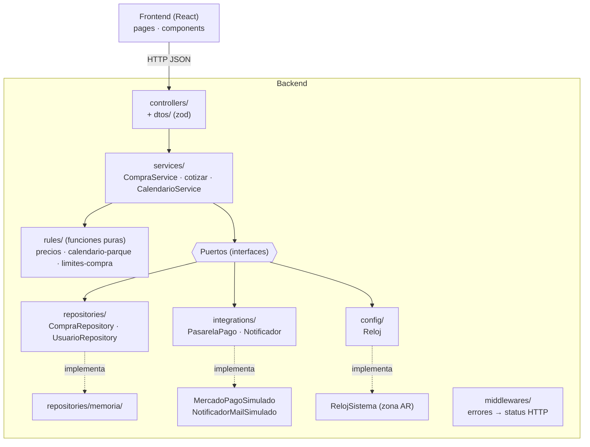

# TP6 – Test Driven Development · Documento de decisiones de diseño

**EcoHarmony Park · User Story "Comprar entradas"**
Ingeniería y Calidad de Software · UTN FRC · Curso 4K3 · Grupo 3 · 2026

---

## 1. Introducción

Este documento justifica las decisiones de diseño tomadas al implementar la User Story
**"Comprar entradas"** (asignada a los grupos impares) aplicando **TDD** con el ciclo
**Red → Green → Refactor**. También presenta la evidencia del ciclo en el historial de Git,
el mapeo entre las pruebas de usuario de la US y los tests automatizados, y la cobertura
obtenida.

### 1.1 User Story

> **COMO** visitante **QUIERO** comprar una entrada **PARA** asegurar mi visita al parque.

**Criterios de aceptación**

1. Debe indicar la fecha de visita deseada, la cantidad de entradas, la edad de cada visitante y el tipo de pase (VIP o regular).
2. La fecha de visita puede ser del día actual o futura.
3. Debe enviar un mensaje de confirmación vía mail.
4. Debe redirigir a Mercado Pago al confirmar la compra si el pago es con tarjeta.
5. La fecha de visita debe estar dentro de los días en que el parque está abierto.
6. Debe seleccionar la forma de pago: efectivo (boletería) o tarjeta.
7. La cantidad de entradas no debe ser mayor a 10.
8. Al finalizar la compra se debe informar la cantidad de entradas compradas y la fecha.
9. Se debe permitir la compra sólo a usuarios registrados.

**Pruebas de usuario**

| # | Prueba | Resultado esperado |
|---|---|---|
| PU1 | Compra con fecha disponible, menos de 10 entradas, edades, tipo de pase, pago con tarjeta mediante Mercado Pago y recepción del mail | Pasa |
| PU2 | Compra sin seleccionar forma de pago | Falla |
| PU3 | Compra con una fecha en la que el parque está cerrado | Falla |
| PU4 | Compra de más de 10 entradas | Falla |

---

## 2. Stack tecnológico y guía de estilo

| Capa | Tecnología | Motivo |
|---|---|---|
| Lenguaje | TypeScript (modo `strict`) | Tipado estático en backend y frontend; los contratos (entidades, puertos) quedan explícitos |
| Tests | Vitest | Rápido, con modo watch: ideal para ciclos Red-Green cortos |
| Tests de API | Supertest | Prueba los endpoints sin levantar un servidor real |
| Tests de UI | Testing Library + user-event + jsdom | Prueba la interfaz como la usa el visitante (roles, etiquetas, clicks) |
| Backend | Node.js + Express 5 | Simple y conocido; maneja errores de handlers `async` |
| Validación de entrada | Zod | Valida la forma del body en los DTOs |
| Frontend | React 19 + Vite + React Router | SPA web responsive (FAQ 24) |
| Estilo de código | ESLint con **guía Airbnb** (`eslint-config-airbnb-extended`) + Prettier | Guía de estilo elegida por el grupo; se verifica con `npm run lint` |

Excepciones a la guía de estilo, acotadas y justificadas:

- `max-classes-per-file` desactivada sólo en `src/errors/`: los errores de negocio son clases mínimas y se agrupan en un único archivo.
- `react/react-in-jsx-scope` y `react/jsx-uses-react` desactivadas: con el JSX runtime automático de React 17+ no se importa `React`.
- `no-console` permitido puntualmente en el notificador de mails simulado, donde la consola *es* el envío simulado.

---

## 3. Arquitectura

Arquitectura **por capas** (`controller → service → repository`) con las **reglas de negocio
aisladas en funciones puras** y las dependencias externas detrás de **interfaces (puertos)**
que se inyectan por constructor.

| Carpeta | Responsabilidad |
|---|---|
| `entities/` | Tipos del dominio: `TipoPase`, `FormaPago`, `EntradaSolicitada`, `Compra`, `Usuario`, `Momento` |
| `rules/` | Reglas de negocio puras, sin dependencias de infraestructura |
| `errors/` | Un error tipado por regla incumplida (`ParqueCerradoError`, `CantidadInvalidaError`…) |
| `services/` | Casos de uso: orquestan reglas y puertos |
| `repositories/` | Interfaces de persistencia + implementación en memoria |
| `integrations/` | Interfaces de Mercado Pago y mail + implementaciones simuladas |
| `config/` | `Reloj`: fecha y hora actuales en la zona horaria del parque |
| `dtos/` | Forma del body de cada request |
| `controllers/` · `routes.ts` · `app.ts` | Capa HTTP |
| `middlewares/` | Traducción de errores de negocio a códigos HTTP |
| `server.ts` | Composición de dependencias de la aplicación real |

---

## 4. Decisiones de diseño

### D1. Reglas de negocio como funciones puras (`rules/`)

Precios, calendario y límites no dependen de Express, de la persistencia ni de la hora del
sistema. Se prueban de forma aislada, rápida y determinística, y fueron el primer código
escrito con TDD: el resto del sistema se construyó sobre reglas ya probadas.

### D2. Inyección de dependencias por constructor

`CompraService` recibe `CompraRepository`, `UsuarioRepository`, `PasarelaPago`, `Notificador`
y `Reloj`. En los tests se le pasan dobles (`vi.fn`) o los adaptadores en memoria; en
`server.ts`, las implementaciones simuladas. Esto permite verificar, por ejemplo, que **si una
validación falla no se cobra, no se registra y no se envía mail**.

### D3. El tiempo es una dependencia (`Reloj` / `Momento`)

Las reglas de fecha reciben `ahora` como parámetro (`{ fecha: "YYYY-MM-DD", hora: "HH:mm" }`)
en lugar de consultar `new Date()`. Así **ningún test depende del día en que se ejecuta**
(se fija "ahora" en cada caso) y se pueden probar bordes como las 17:30 / 17:31 o fin de mes.
`RelojSistema` calcula la fecha y hora en `America/Argentina/Buenos_Aires`, y las fechas se
manipulan en UTC, evitando los corrimientos por zona horaria.

### D4. Errores de negocio tipados

Cada regla lanza un error propio que extiende `ErrorDeNegocio`. Los tests verifican el *tipo*
de error (y no un texto), y el middleware los traduce a HTTP en un único lugar:

| Error | Status |
|---|---|
| `SolicitudInvalidaError` (body mal formado) | 400 |
| `UsuarioNoRegistradoError` | 401 |
| `PagoRechazadoError` | 402 |
| Cualquier otra regla incumplida | 422 |

### D5. Validación en dos niveles

Los DTOs (Zod) sólo validan la **forma** del body (400). Las **reglas de negocio** (forma de
pago válida, rango de edad, tipo de pase, fechas) se validan en `rules/` y `services/` (422).
Así la prueba de usuario "compra sin forma de pago" se resuelve con una regla de negocio
probada en el service, independiente de la capa HTTP.

### D6. Orden del caso de uso: validar → cobrar → registrar → notificar

Se valida todo antes de cobrar. Se cobra antes de registrar: si Mercado Pago rechaza el pago
no queda una compra registrada sin pagar. El mail se envía sólo después de registrar.

### D7. Integraciones simuladas detrás de interfaces

Mercado Pago y el envío de mails están simulados, como habilita el PO (FAQ 4 y 5).
`MercadoPagoSimulado` devuelve la URL de una pantalla "Mercado Pago – Compra exitosa" y el
mail se muestra en un modal "Mail enviado a …" y por consola. Reemplazarlos por los reales
sólo requiere otra implementación de la interfaz, sin tocar el service.

### D8. Persistencia en memoria y sesión mockeada

La consigna no exige base de datos y el PO permite mockear la sesión (FAQ 19). El repositorio
en memoria cumple la misma interfaz que tendría uno real. El usuario logueado se identifica
con el header `x-usuario-id`.

### D9. El precio se calcula sólo en el backend

El frontend no duplica reglas: consulta `POST /api/compras/cotizar` para mostrar el precio de
cada entrada y el total a medida que se completan las edades, y `GET /api/calendario` para
saber qué días deshabilitar en el calendario (FAQ 2) y por qué.

### D10. Frontend probado desde el punto de vista del usuario

Los tests de UI buscan elementos por rol y etiqueta accesible (`getByRole`, `getByLabelText`)
y simulan interacciones reales con `user-event`; el cliente de la API se mockea. Esto obliga
además a que la interfaz sea accesible (botones con nombre, campos con etiqueta, modal con
`role="dialog"`, errores con `role="alert"`).

### D11. Interfaz responsive con la identidad del parque

Paleta y fuente indicadas por el PO (FAQ 3: `#386641 #6A994E #A7C957 #F2E8CF #BC4749`, Lato)
definidas como variables CSS. Layout fluido con ancho máximo, grilla adaptable en el
calendario, formulario de visitante que pasa a una columna por debajo de 480 px y controles
táctiles de al menos 44 px (FAQ 24).

---

## 5. Reglas de negocio y tests que las cubren

| Regla | Fuente | Implementación | Tests |
|---|---|---|---|
| Común $10.000 · VIP $20.000 | FAQ 6, 21 | `rules/precios.ts` | `tests/rules/precios.test.ts` |
| ≤ 3 años gratis · ≤ 15 años 50% · ≥ 60 años 50% | FAQ 7 | `rules/precios.ts` | `tests/rules/precios.test.ts` (bordes 3/4, 15/16, 59/60) |
| Cerrado lunes, 25/12 y 1/1 | FAQ 1, CA 5 | `rules/calendario-parque.ts` | `tests/rules/calendario-parque.test.ts` |
| Fecha de hoy o futura | CA 2 | `validarFechaVisita` | ídem |
| Hasta 1 mes de anticipación | FAQ 25 | `validarFechaVisita` | ídem (14/10 → 14/11 ✓, 15/11 ✗; 31/01 → 28/02) |
| Mismo día hasta las 17:30 | FAQ 26 | `validarFechaVisita` | ídem (17:30 ✓, 17:31 ✗) |
| 1 a 10 entradas por compra | CA 7 | `rules/limites-compra.ts` | `tests/rules/limites-compra.test.ts` |
| Máx. 10 entradas por usuario y fecha (acumulado) | FAQ 27 | `validarLimiteAcumulado` + `CompraRepository` | `limites-compra.test.ts`, `compra.service.test.ts` |
| Edad entera de 0 a 120 y tipo de pase por entrada | CA 1 | `validarEntradas` | `limites-compra.test.ts` |
| Forma de pago obligatoria (efectivo / tarjeta) | CA 6 | `CompraService` | `compra.service.test.ts`, `api.test.ts` |
| Tarjeta → redirección a Mercado Pago | CA 4, FAQ 4 | `CompraService.cobrar` + `MercadoPagoSimulado` | `compra.service.test.ts`, `api.test.ts`, `flujo-compra.test.tsx` |
| Mail de confirmación con el detalle | CA 3, FAQ 5 | `resumen-compra.ts` + `Notificador` | `compra.service.test.ts`, `flujo-compra.test.tsx` |
| Informar cantidad y fecha al finalizar | CA 8 | `construirMensajeConfirmacion` + `Confirmacion` | `compra.service.test.ts`, `flujo-compra.test.tsx` |
| Sólo usuarios registrados | CA 9, FAQ 19 | `CompraService` + controller | `compra.service.test.ts`, `api.test.ts` |
| Días cerrados deshabilitados en el calendario | FAQ 2 | `CalendarioService` + `Calendario` | `api.test.ts`, `formulario-compra.test.tsx` |

---

## 6. Supuestos

| Supuesto | Detalle |
|---|---|
| Ventana de compra | Desde hoy hasta el mismo día del mes siguiente, inclusive. Si ese día no existe, el último día del mes siguiente (31/01 → 28/02). |
| Rango de edad | Número entero entre 0 y 120, inclusive. |
| Tipo de pase | Se elige por cada entrada; una compra puede mezclar VIP y Común. |
| Zona horaria | La fecha "de hoy" y la hora de corte se evalúan en hora de Argentina. |
| Sesión | Usuario único mockeado, identificado por el header `x-usuario-id`. |
| Pago con tarjeta | Los datos de la tarjeta se ingresan en Mercado Pago; el sistema sólo envía el monto y recibe la URL de redirección. |
| Mail con pago en efectivo | También se envía la confirmación (el criterio de aceptación no distingue forma de pago). |
| Persistencia | En memoria; se pierde al reiniciar el backend. |

---

## 7. Evidencia del ciclo TDD

### 7.1 Forma de trabajo

- Cada módulo comenzó con un commit **`test:`** con sus tests (fase **Red**). Antes de
  commitear se ejecutó la suite y se verificó que esos tests fallaban.
- Le siguieron uno o más commits **`feat:`** con el código para hacerlos pasar (fase
  **Green**). Los `feat:` intermedios de un módulo pueden dejar algunos de sus tests todavía
  en rojo; el último deja toda la suite en verde, con lint y verificación de tipos sin errores.
- En las fases 1, 2 y 4 se hicieron commits **`refactor:`** separados, con la suite en verde
  antes y después. Desde la fase 5 el refactor se aplicó dentro del mismo `feat:` (Green +
  Refactor en un commit) para mantener el historial compacto.
- Para no generar un commit por cada test, **los ciclos se agruparon por módulo**.

### 7.2 Ciclos

| Módulo | Red (`test:`) | Green (`feat:`) | Refactor |
|---|---|---|---|
| **Reglas de precios** | `efb4ec2` reglas de precios por tipo de pase y edad | `63898b3` precio por tipo de pase · `59fe06e` descuentos por edad · `cb1fbc1` total de la compra | `6eecdab` descuentos como lista de reglas |
| **Calendario y fecha de visita** | `2033073` reglas de calendario y fecha de visita | `ad7365d` días en que el parque está abierto · `4d1294e` ventana de compra y hora de corte | `29a1c01` utilidades de fechas |
| **Cantidad, edad y tipo de pase** | `f6183c4` reglas de cantidad, edad y tipo de pase | `42c37c6` cantidad por compra · `f1a1155` edad y pase por entrada · `003fccf` límite acumulado | — |
| **Servicio de compra** | `edcfdd0` servicio de compra de entradas | `7b2fce3` registrar compra validando reglas · `e11c851` pago con tarjeta y mail | `7dabcec` construcción del resumen de compra |
| **Adaptadores** | `a3fec76` adaptadores en memoria y simulados | `4c22bda` repositorios en memoria e integraciones simuladas | (en el `feat:`) |
| **API** | `44dda6c` endpoints de compra, cotización y calendario | `269ce0f` API de compra, cotización y calendario | (en el `feat:`) |
| **Formulario (frontend)** | `fb95eb7` formulario de compra de entradas | `36f98ac` formulario de compra de entradas | (en el `feat:`) |
| **Confirmación y pago simulado** | `3c728f6` confirmación de compra y pago simulado | `020d9b1` confirmación de compra y pago simulado | (en el `feat:`) |
| **Precio por entrada** | `8626001` precio individual de cada entrada | `cc17007` mostrar el precio individual | (en el `feat:`) |
| **Precios en tiempo real** | `2122321` actualizar precios y total al completar entradas | `9296663` actualizar precios y total al completar entradas | (en el `feat:`) |

Commits de soporte: `62d581b` y `f64146d` (`chore:` setup de backend y frontend), `d1886eb`
(`chore:` finales de línea LF) y los `docs:` del plan.

### 7.3 Ejemplos de la fase Red

- **Precios:** el commit `efb4ec2` agrega 17 tests que fallan porque `rules/precios.ts` no
  existe. `63898b3` hace pasar los de precio base; los de descuentos y total siguen en rojo
  hasta `59fe06e` y `cb1fbc1`.
- **Servicio de compra:** `edcfdd0` agrega 15 tests. Tras `7b2fce3` quedan en rojo sólo los 4
  que involucran tarjeta y mail, que pasan en `e11c851`.
- **Precios en tiempo real:** `2122321` reemplaza el test "no muestra precios mientras falte
  una edad" por los nuevos comportamientos pedidos; fallan hasta `9296663`.

### 7.4 Tests que pasaron desde la fase Red

Algunos tests se escribieron como **protección** y ya pasaban al momento de escribirlos:
por ejemplo, "al quitar una entrada el total se actualiza" (`2122321`) cubre un
comportamiento que el código anterior ya tenía, y se mantiene para evitar regresiones.

---

## 8. Pruebas de usuario automatizadas

| Prueba de usuario | Service (`compra.service.test.ts`) | API (`api.test.ts`) | Frontend |
|---|---|---|---|
| **PU1** Compra con tarjeta, Mercado Pago y mail (pasa) | "cobra el total en Mercado Pago, redirige y envía el mail" | "con tarjeta responde la URL de Mercado Pago a la que redirigir" | `flujo-compra.test.tsx`: "redirige a Mercado Pago, que informa la compra exitosa" y "al volver de Mercado Pago muestra la confirmación y el mail enviado" |
| **PU2** Sin forma de pago (falla) | "rechaza una compra sin forma de pago" | 422 "sin forma de pago" | `formulario-compra.test.tsx`: "está deshabilitado sin forma de pago aunque el resto esté completo" |
| **PU3** Parque cerrado (falla) | "rechaza una fecha en la que el parque está cerrado" | 422 "fecha con el parque cerrado" | `formulario-compra.test.tsx`: "deshabilita los días en que no se puede comprar y habilita el resto" |
| **PU4** Más de 10 entradas (falla) | "rechaza una compra de más de 10 entradas" | 422 "más de 10 entradas" | `formulario-compra.test.tsx`: "no permite superar las 10 entradas" |

---

## 9. Resultados de los tests y cobertura

### 9.1 Tests

| Suite | Archivo | Tests |
|---|---|---:|
| Backend | `tests/rules/precios.test.ts` | 17 |
| Backend | `tests/rules/calendario-parque.test.ts` | 23 |
| Backend | `tests/rules/limites-compra.test.ts` | 17 |
| Backend | `tests/services/compra.service.test.ts` | 15 |
| Backend | `tests/adapters/adaptadores.test.ts` | 10 |
| Backend | `tests/api/api.test.ts` | 17 |
| Backend | `tests/smoke.test.ts` | 1 |
| Frontend | `tests/formulario-compra.test.tsx` | 15 |
| Frontend | `tests/flujo-compra.test.tsx` | 7 |
| **Total** | | **122** |

Todos los tests pasan.

### 9.2 Cobertura del backend (`npm run test:coverage`)

| Métrica | Cobertura |
|---|---:|
| Sentencias | 91,8 % |
| Ramas | 80,5 % |
| Funciones | 95,5 % |
| Líneas | 92,2 % |

`rules/`, `entities/`, `errors/`, `repositories/`, `controllers/`, `utils/` y los servicios de
compra y cotización tienen **100 %**. Las partes no cubiertas son:

- `server.ts` (0 %): composición de dependencias de la aplicación real; se verificó levantando
  el servidor manualmente.
- `middlewares/manejador-errores.ts` (45 %): las ramas de JSON mal formado y de error
  inesperado (500) no tienen test automatizado. El caso de JSON mal formado se verificó
  manualmente.
- `services/calendario.service.ts` (93 %): la rama que relanza un error que no es de negocio.
- `integrations/notificador-mail-simulado.ts` (80 %): la impresión por consola, que sólo se
  activa en el servidor real.
- `config/reloj.ts` (86 % de sentencias): el valor por defecto `new Date()`; los tests
  inyectan una fecha fija.

---

## 10. Ejecución

Ver el [README](../README.md) para instalar, levantar la aplicación y ejecutar los tests.
